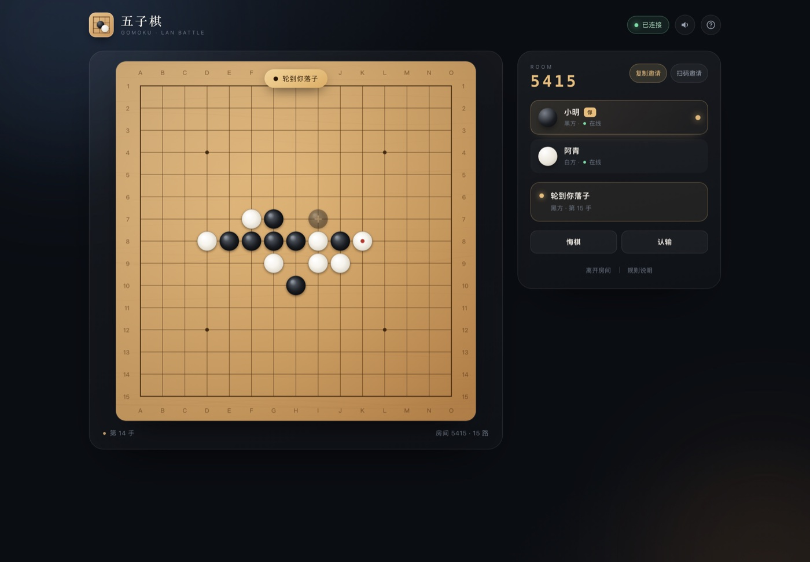
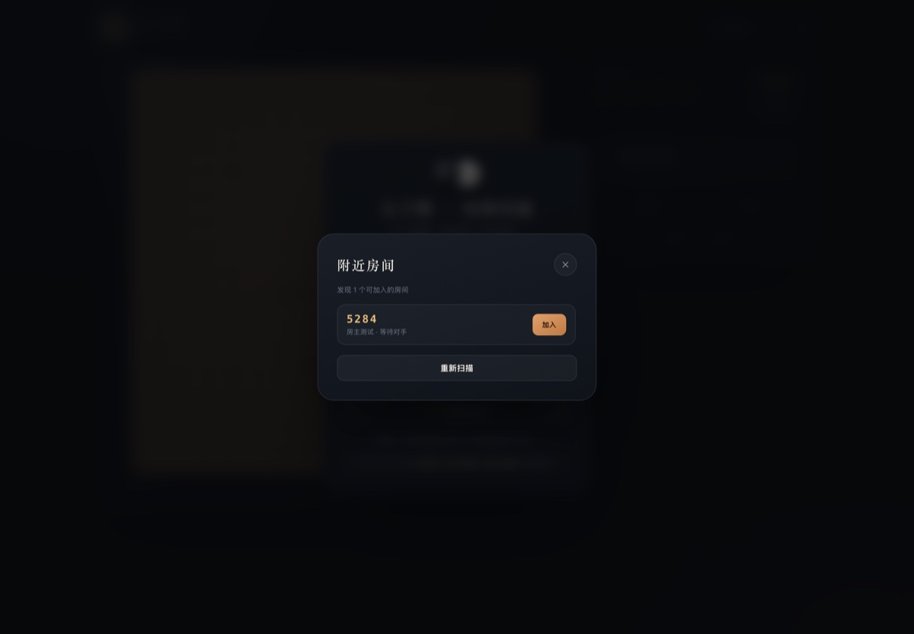
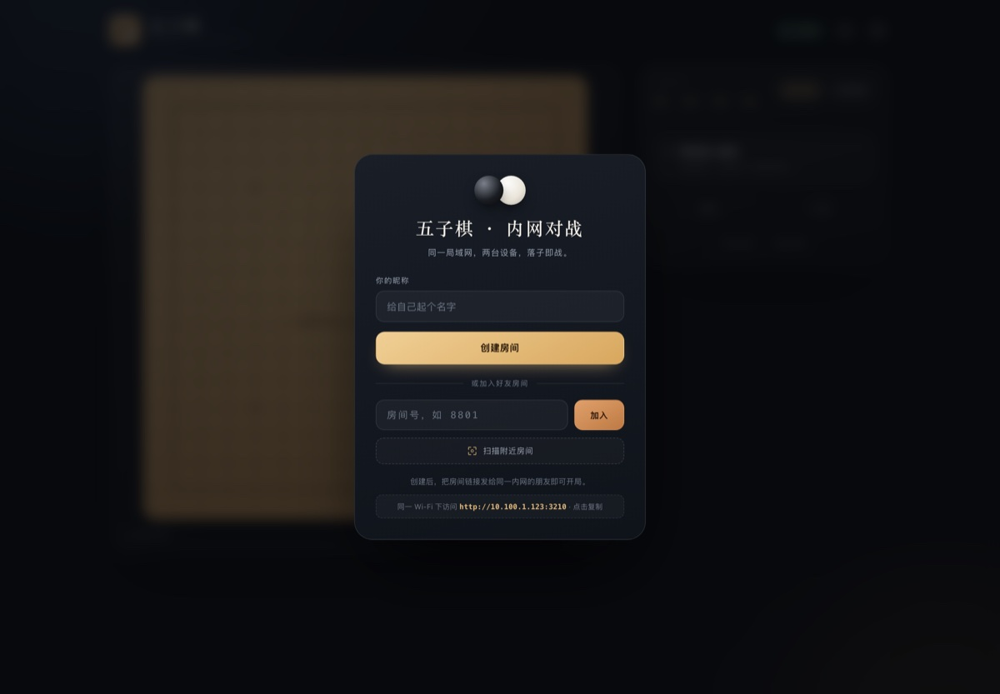
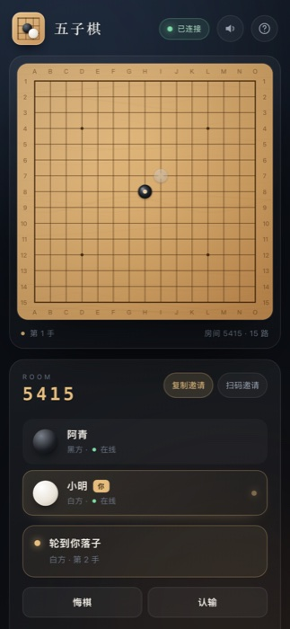
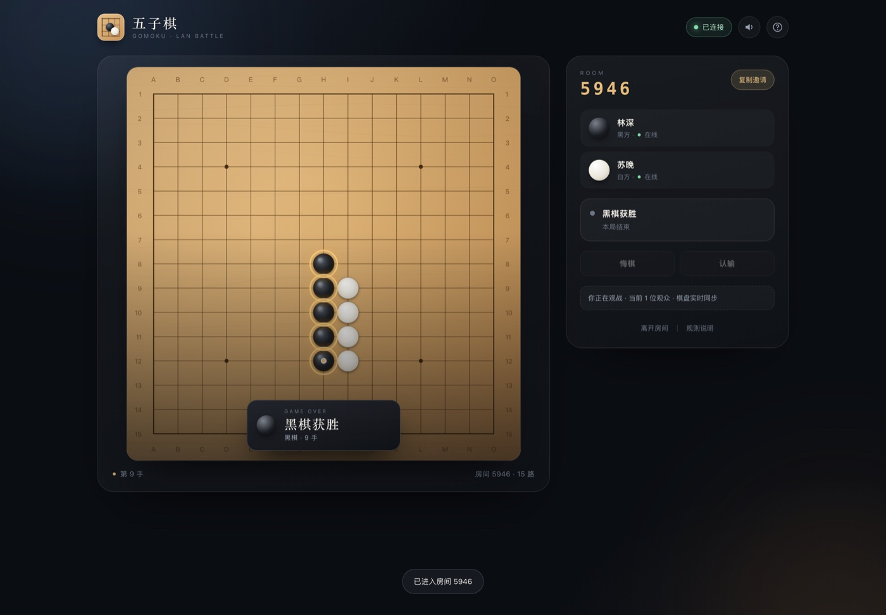

# 五子棋 · 内网双人对战

零依赖的五子棋网页游戏。服务端跑在任意一台内网电脑上，同一 Wi-Fi 下的手机、平板、电脑打开地址即可开房对战。



## 功能

- **开箱即用**：只需 Node.js ≥ 18，`npm start` 一条命令启动，无需安装依赖、无需构建。
- **内网联机**：房间号、邀请链接、邀请二维码三种入口，链接自动使用局域网 IP。
- **附近房间扫描**：一键扫描当前服务里所有有空位的房间，点「加入」即可开战，不用手输房间号。
- **扫码邀请**：房间内点「扫码邀请」生成二维码，手机用系统相机一扫即进房。
- **完整对局**：15 × 15 棋盘，黑先白后，横 / 竖 / 斜五连（长连有效），满盘和棋。
- **悔棋协商**：发起悔棋后由对手同意或拒绝，同意后撤销最近一手。
- **再来一局**：双方都确认后重开，自动交换黑白，保证公平。
- **认输 / 观战**：可认输；房间满员后第三人自动观战，棋盘实时同步。
- **断线重连**：刷新或短暂断网后自动回到原座位，棋局不丢。
- **体验细节**：落子预览、落子动画、胜利连线高亮、音效开关、移动端自适应。

| 附近房间扫描 | 扫码邀请 |
| --- | --- |
|  |  |

| 大厅 | 移动端 |
| --- | --- |
|  |  |

## 快速开始

```bash
cd gomoku
npm start
```

启动后终端会打印访问地址：

```
  ♟  五子棋 · 内网双人对战
  ──────────────────────────────────────────────
  访问地址  http://localhost:3210
  访问地址  http://10.100.1.123:3210   ← 内网地址
  ──────────────────────────────────────────────
```

1. 房主在电脑上打开 `http://localhost:3210`，填写昵称，点击「创建房间」。
2. 点击「扫码邀请」展示二维码，或点「复制邀请」把链接发给同一局域网的朋友；对方也可点「扫描附近房间」直接找到并加入。
3. 两人到齐自动开局，黑棋先行，点击棋盘交叉点落子。
4. 对局结束后点击「再来一局」，双方都确认后交换黑白重新开局。

> 手机与电脑需要在**同一个 Wi-Fi** 下；如果打不开，请检查是否连到了访客网络，或在 macOS 防火墙中允许 `node` 接受传入连接。

## 常用命令

```bash
npm start                 # 启动服务（默认 3210 端口）
PORT=8080 npm start       # 指定端口
npm test                  # 规则单测 + 双端联机端到端测试
npm run test:ui           # 无头 Chrome 走完整 UI 流程并截图（需本机 Chrome）
npm run demo              # 开一间机器人对局，方便预览
```

## 规则



| 项目 | 说明 |
| --- | --- |
| 棋盘 | 15 × 15 |
| 先手 | 黑棋 |
| 胜负 | 横、竖、任意斜线连续五子及以上即胜（无禁手） |
| 平局 | 225 个交叉点落满仍未分胜负 |
| 悔棋 | 需对方同意，撤销最近一手 |
| 再来一局 | 对局结束后双方确认，交换黑白 |

## 目录结构

```
gomoku/
├── server.js             # HTTP 静态服务 + WebSocket + 房间/对局编排
├── lib/
│   ├── game.js           # 纯规则：落子、五连判定、悔棋、和棋
│   └── ws.js             # 零依赖 WebSocket 服务端（RFC 6455）
├── public/
│   ├── index.html        # 页面结构
│   ├── styles.css        # 深色质感 UI / 响应式
│   ├── app.js            # Canvas 棋盘、联机状态机、交互
│   └── vendor/
│       └── qrcode.js     # 二维码生成库（MIT，qrcode-generator 2.0.4）
├── tools/
│   ├── rules-test.js     # 规则单元测试
│   ├── e2e.js            # 双客户端联机测试（真实 WebSocket）
│   ├── ui-check.js       # 无头 Chrome UI 流程 + 截图
│   ├── demo-room.js      # 机器人对局演示
│   └── ws-client.js      # 测试用极简 WebSocket 客户端
├── docs/                 # 预览截图
├── start.command         # macOS 双击启动
└── README.md
```

## 实现说明

- **服务端权威**：所有落子、轮次、胜负、悔棋都在服务端校验，客户端只负责渲染，避免两端状态不一致。
- **全量状态同步**：每次变更向房间内所有连接广播完整棋盘快照（225 字节级别的数组），实现简单、观战与重连天然一致。
- **自研 WebSocket**：`lib/ws.js` 处理握手、掩码、分片、ping/pong 与关闭帧；服务端每 30 秒心跳探活。
- **断线恢复**：每个座位有随机 token，保存在 `sessionStorage`；刷新后带着 token 自动回到原座位。房间在无人连接 15 分钟后回收。
- **邀请链接 / 二维码**：前端读取 `/api/info` 返回的局域网地址，即使房主用 `localhost` 打开页面，复制出的链接与二维码也指向可被其他设备访问的 IP。
- **房间扫描**：`GET /api/rooms` 返回所有「有空位且房主在线」的房间；前端弹窗每 4 秒自动刷新，点选即加入。
- **二维码本地生成**：使用 vendored 的 `qrcode-generator`（MIT）在浏览器内生成 SVG，不请求任何外部二维码服务，断网内网也能用。

## 常见问题

**朋友打不开邀请链接？**
确认两台设备在同一局域网、没有开启 AP 隔离；让对方直接访问终端打印的 `http://内网IP:3210`。若公司网络隔离了设备互访，可改用手机热点组网。

**端口被占用？**
`PORT=3211 npm start`，然后把新端口告诉朋友。

**重启服务后房间还在吗？**
房间与棋局保存在内存中，重启服务即清空；同一进程内可同时开多间房。

**为什么「扫描附近房间」看不到朋友的房间？**
扫描的是当前服务下的房间：对方必须已经点「创建房间」并停留在等待页；已满员、已开局或房主已离线超过一段时间的房间不会出现在列表里。点击「重新扫描」可刷新。

**同一浏览器开了两个标签页？**
后打开的标签页会接管该座位，旧标签页转为观战，避免同一方重复落子。

## 第三方依赖

- [qrcode-generator](https://github.com/kazuhikoarase/qrcode-generator) 2.0.4（MIT License）—— 仅在浏览器端生成邀请二维码，已随项目内置，无需联网安装。
