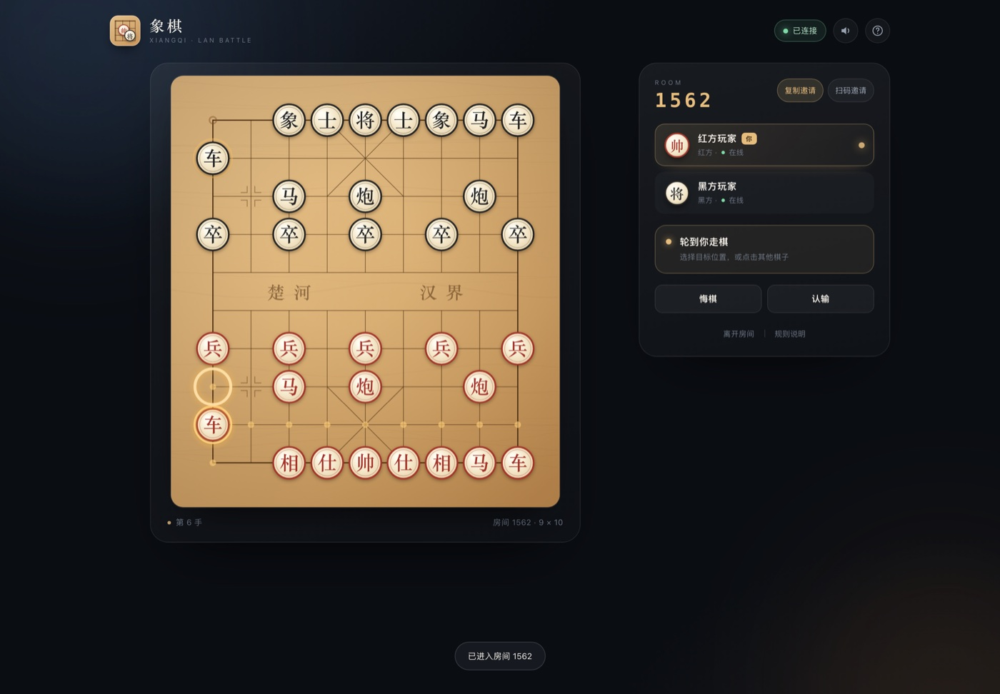
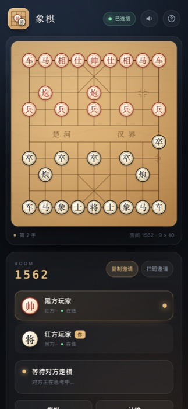
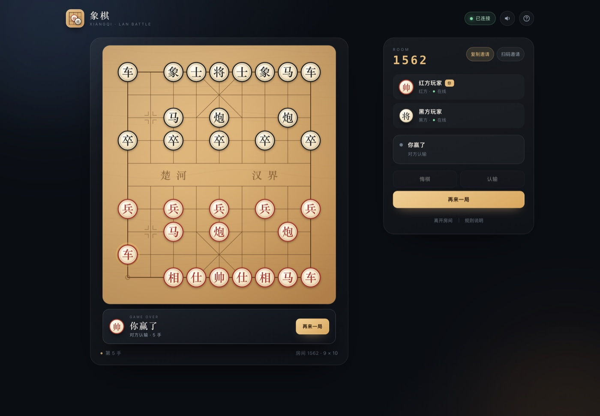

# 中国象棋 · 内网双人对战

零依赖的中国象棋网页游戏。服务端跑在任意一台内网电脑上，同一 Wi-Fi 下的手机、平板、电脑打开地址即可开房对战。



## 功能

- **开箱即用**：只需 Node.js ≥ 18，`npm start` 一条命令启动，无需安装依赖、无需构建。
- **内网联机**：房间号、邀请链接、邀请二维码三种入口，链接自动使用局域网 IP。
- **附近房间扫描**：一键扫描当前服务里所有有空位的房间，点「加入」即可开战。
- **完整规则**：红先黑后，车马炮象士将帅兵卒走法齐全，包含蹩马腿、塞象眼、炮架、过河兵、九宫、白脸将。
- **将死 / 困毙**：将死对方，或对方无合法走法（困毙），均判获胜；连续 60 回合无吃子判和。
- **悔棋协商**：发起悔棋后由对手同意或拒绝，同意后撤销最近一手（自动恢复被吃棋子）。
- **再来一局**：双方都确认后重开，自动交换红黑，保证公平。
- **认输 / 观战**：可认输；房间满员后第三人自动观战，棋盘实时同步。
- **断线重连**：刷新或短暂断网后自动回到原座位，棋局不丢。
- **视角翻转**：执黑一方自动把棋盘旋转 180°，自己的棋子永远在下方；执红方看到红方在下。
- **体验细节**：点击选中、合法落点提示、落子动画、将军红圈、吃子记录、音效、移动端自适应。

| 大厅 | 移动端 |
| --- | --- |
|  |  |

| 附近房间扫描 | 扫码邀请 |
| --- | --- |
|  |  |



## 快速开始

```bash
cd xiangqi
npm start
```

启动后终端会打印访问地址（默认 3211 端口）：

```
  ♟  中国象棋 · 内网双人对战
  ──────────────────────────────────────────────
  访问地址  http://localhost:3211
  访问地址  http://10.100.1.123:3211   ← 内网地址
  ──────────────────────────────────────────────
```

1. 房主打开 `http://localhost:3211`，填写昵称，点击「创建房间」。
2. 点击「扫码邀请」展示二维码，或「复制邀请」把链接发给朋友；对方也可点「扫描附近房间」直接加入。
3. 两人到齐自动开局，红方先行；点自己的棋子，再点目标位置走棋。
4. 对局结束后点「再来一局」，双方确认后交换红黑重新开局。

> 手机与电脑需要在**同一个 Wi-Fi** 下；如果打不开，请检查是否连到了访客网络，或在 macOS 防火墙中允许 `node` 接受传入连接。

## 常用命令

```bash
npm start                 # 启动服务（默认 3211 端口）
PORT=8081 npm start       # 指定端口
npm test                  # 规则单测 + 双端联机端到端测试
npm run test:ui           # 无头 Chrome 走完整 UI 流程并截图（需本机 Chrome）
npm run demo              # 开一间机器人对局，方便预览
```

## 规则摘要

| 项目 | 说明 |
| --- | --- |
| 棋盘 | 9 路 × 10 行，中间楚河汉界 |
| 先手 | 红方 |
| 车 | 横竖任意距离，不能越子 |
| 马 | 走“日”，蹩马腿不能走 |
| 炮 | 走直线；吃子必须隔一个炮架 |
| 象 / 相 | 走“田”，塞象眼不能走，不能过河 |
| 士 / 仕 | 只能在九宫内斜走一步 |
| 将 / 帅 | 九宫内横竖一步；双方将帅不能照面 |
| 兵 / 卒 | 过河前只能向前，过河后可左右横走 |
| 胜负 | 将死或困毙对方即胜；60 回合无吃子判和 |
| 悔棋 | 需对方同意，撤销最近一手 |
| 再来一局 | 对局结束后双方确认，交换红黑 |

## 目录结构

```
xiangqi/
├── server.js             # HTTP 静态服务 + WebSocket + 房间/对局编排
├── lib/
│   ├── rules.js          # 象棋规则：走法、将军、将死、困毙、悔棋
│   └── ws.js             # 零依赖 WebSocket 服务端（RFC 6455）
├── public/
│   ├── index.html        # 页面结构
│   ├── styles.css        # 深色质感 UI / 响应式
│   ├── app.js            # Canvas 棋盘、联机状态机、交互
│   └── vendor/
│       └── qrcode.js     # 二维码生成库（MIT，qrcode-generator 2.0.4）
├── tools/
│   ├── rules-test.js     # 规则单元测试
│   ├── e2e.js            # 双客户端联机测试
│   ├── ui-check.js       # 无头 Chrome UI 流程 + 截图
│   └── ws-client.js      # 测试用极简 WebSocket 客户端
├── docs/                 # 预览截图
├── start.command         # macOS 双击启动
└── README.md
```

## 实现说明

- **服务端权威**：走法合法性、轮次、将军、将死、困毙、悔棋全部在服务端校验。
- **合法落点下发**：每次状态广播附带当前行棋方的所有合法走法，前端直接用金色圆点提示，避免前后端规则不一致。
- **全量状态同步**：每次变更广播完整棋盘快照（90 个格子），观战与断线重连天然一致。
- **自研 WebSocket**：`lib/ws.js` 处理握手、掩码、分片、ping/pong 与关闭帧；服务端每 30 秒心跳探活。
- **悔棋恢复**：历史记录保存被吃棋子与“无吃子回合计数”，悔棋时完整还原。
- **邀请链接 / 二维码**：前端读取 `/api/info` 返回的局域网地址；二维码使用 vendored 的 `qrcode-generator` 在浏览器本地生成，断网内网也能用。
- **房间扫描**：`GET /api/rooms` 返回所有有空位且房主在线的房间，弹窗每 4 秒自动刷新。

## 常见问题

**朋友打不开邀请链接？**
确认两台设备在同一局域网、没有开启 AP 隔离；让对方直接访问终端打印的 `http://内网IP:3211`。

**端口被占用？**
`PORT=3212 npm start`，然后把新端口告诉朋友。

**为什么「扫描附近房间」看不到朋友的房间？**
扫描的是当前服务下、仍有空位且房主在线的房间；已满员、已开局或房主离线的房间不会出现。点「重新扫描」可刷新。

**重启服务后房间还在吗？**
房间与棋局保存在内存中，重启服务即清空；同一进程内可同时开多间房。

## 第三方依赖

- [qrcode-generator](https://github.com/kazuhikoarase/qrcode-generator) 2.0.4（MIT License）—— 仅在浏览器端生成邀请二维码，已随项目内置，无需联网安装。
